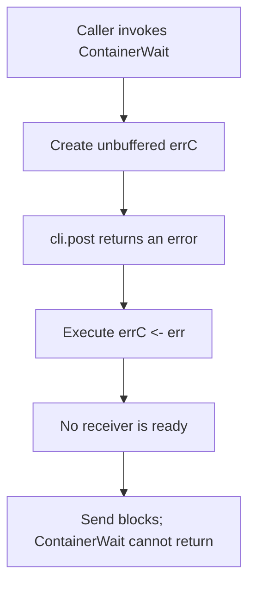
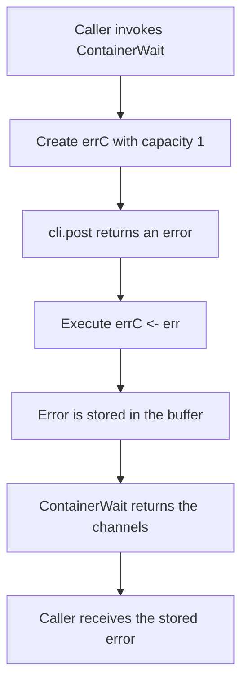
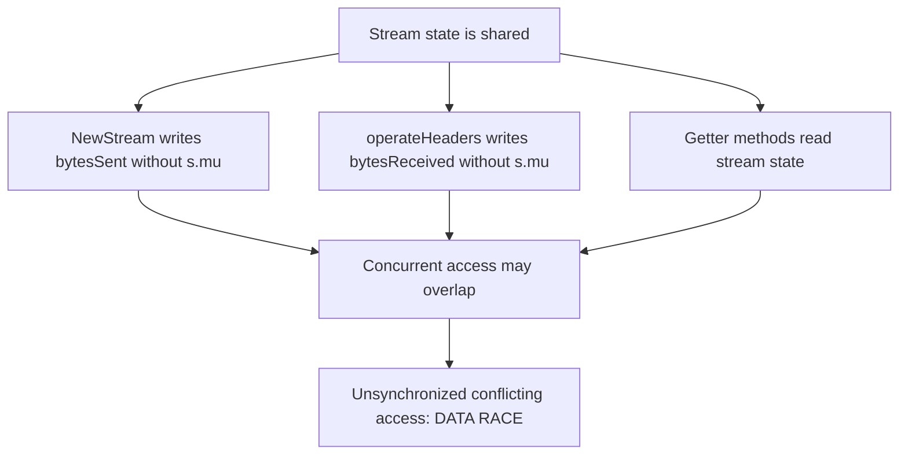
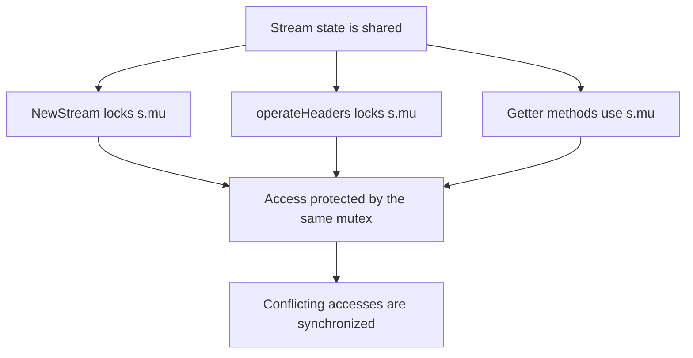

# Technical Mechanism Analysis: C1 Docker ContainerWait and C3 gRPC-go Data Race

**Course:** CS340 Research Paper Replication  
**Responsible role:** Student B — Technical Mechanism  
**Scope:** Original bug mechanisms, buggy/fixed code comparison, execution flows, and Go Race Detector overview.

> Scope note: This document analyzes the original patch logic and the repository's existing minimal reproductions. It does not claim that the complete historical Docker or gRPC-go projects were reproduced end to end. The existing project notes identify these as minimal or field-level reproductions.

---

## 1. C1 — Docker ContainerWait Blocking Bug

### 1.1 Bug information

- Project: Docker
- Original fix commit: `4d2d2ea39336aade783c5c415b83d129bdd339bb`
- File: `client/container_wait.go`
- Bug category: Blocking bug
- Main mechanism: Sending to an unbuffered channel when no receiver is ready.

### 1.2 Original code and cause

The original implementation creates the error channel and sends the request error when `cli.post()` fails:

```go
resultC := make(chan container.ContainerWaitOKBody)
errC := make(chan error)

resp, err := cli.post(ctx, "/containers/"+containerID+"/wait", query, nil, nil)
if err != nil {
    defer ensureReaderClosed(resp)
    errC <- err
    return resultC, errC
}
```

An unbuffered channel requires a sender and receiver to rendezvous. When `cli.post()` returns an error, the function attempts `errC <- err` before it returns `errC` to its caller. Therefore, the caller has not yet received the channel and cannot receive the error. The send operation blocks, preventing `ContainerWait()` from returning.

### 1.3 Fixed code

The official patch changes the channel creation from:

```go
errC := make(chan error)
```

to:

```go
errC := make(chan error, 1)
```

A channel with buffer capacity 1 can store this error value even when the caller is not receiving at that exact moment. The send can complete, allowing the function to return the channels to the caller. The caller can then receive the stored error.

### 1.4 Execution flow

**Buggy version**



**Fixed version**



### 1.5 Key comparison

| Item | Buggy | Fixed |
|---|---|---|
| Channel creation | `make(chan error)` | `make(chan error, 1)` |
| Send behavior | Blocks if no receiver is ready | One error can be buffered |
| Function return | May be prevented by the blocked send | Can return after buffering the error |
| Main issue | Sender and receiver are not ready at the same time | Buffer decouples sending from immediate receiving |

**Conclusion:** C1 is a blocking concurrency bug caused by sending to an unbuffered channel before the caller can receive from that channel. The one-element buffer removes the immediate sender-receiver rendezvous requirement for this error send.

---

## 2. C3 — gRPC-go Data Race

### 2.1 Bug information

- Project: gRPC-go
- Original fix commit: `40e7a759a035a36611d6c9a3c2acb11ce1497727`
- File: `transport/http2_client.go`
- Bug category: Non-blocking bug (Data Race)
- Shared fields: `bytesSent` and `bytesReceived`
- Main mechanism: Concurrent access to shared fields without consistent synchronization.

### 2.2 Shared fields and access paths

The two Boolean fields record stream state:

| Field | Meaning | Write location in the historical code |
|---|---|---|
| `bytesSent` | Whether bytes have been sent for the stream | `http2Client.NewStream()` |
| `bytesReceived` | Whether bytes have been received for the stream | `http2Client.operateHeaders()` |

The fields are also read by the corresponding getter methods. The existing repository analysis records that these getter methods use the stream mutex, `s.mu`.

A mutex used only by a reader does not protect the field from a writer that accesses it without acquiring the same mutex. All conflicting accesses to the shared field must follow a consistent synchronization mechanism.

### 2.3 Original code and official fix

For `bytesSent`, the official patch adds:

```go
s.mu.Lock()
s.bytesSent = true
s.mu.Unlock()
```

For `bytesReceived`, the official patch adds:

```go
s.mu.Lock()
s.bytesReceived = true
s.mu.Unlock()
```

Before the patch, these assignments were not protected by `s.mu`. After the patch, the writes use the same mutex as the corresponding getter reads. This establishes synchronization between the accesses and prevents the conflicting unsynchronized access reported by the Race Detector.

### 2.4 Execution flow

**Buggy version**



**Fixed version**



### 2.5 Key comparison

| Item | Buggy | Fixed |
|---|---|---|
| `bytesSent` write | No `s.mu` protection | Protected by `s.mu` |
| `bytesReceived` write | No `s.mu` protection | Protected by `s.mu` |
| Getter reads | Use the mutex, according to the existing code analysis | Continue using the same mutex |
| Synchronization | Inconsistent between reads and writes | Reads and writes use the same mutex |
| Expected detector result | Data Race may be reported | No race for these protected accesses |

**Conclusion:** C3 is a non-blocking Data Race issue. The official patch protects both state-field writes with the stream mutex, matching the synchronization used by the getter reads.

---

## 3. Go Race Detector

### 3.1 Purpose and basic operation

Go's Race Detector is a runtime tool for detecting data races. It instruments memory accesses in a program built or run with the `-race` option. During execution, it tracks accesses from different goroutines and reports conflicting accesses to the same memory location when they are not properly synchronized.

Example commands:

```bash
go run -race main.go
go test -race ./...
```

A report commonly includes the conflicting access locations and goroutine stack traces. These traces help identify which code paths performed the accesses.

### 3.2 What a Data Race means

A data race occurs when multiple goroutines access the same memory location concurrently, at least one access is a write, and the accesses are not properly synchronized.

For example, an unsynchronized read and write of the same field may constitute a data race:

```go
// Goroutine A
s.bytesSent = true

// Goroutine B
fmt.Println(s.bytesSent)
```

Using the same mutex for both accesses provides synchronization:

```go
// Goroutine A
s.mu.Lock()
s.bytesSent = true
s.mu.Unlock()

// Goroutine B
s.mu.Lock()
fmt.Println(s.bytesSent)
s.mu.Unlock()
```

### 3.3 Limitations

1. **Runtime coverage:** The detector can only report races on execution paths that are actually exercised.
2. **Scheduling dependence:** A race may not manifest in every run because goroutine scheduling and timing vary.
3. **Performance overhead:** Race detection adds runtime and memory overhead.
4. **No report is not proof of correctness:** A clean test run does not prove that the entire program is race-free.
5. **Not a general concurrency-bug detector:** It is designed to detect data races, not every deadlock, channel-blocking problem, or goroutine leak.

### 3.4 Relationship to C1 and C3

| Case | Bug type | Main verification approach |
|---|---|---|
| C1 Docker ContainerWait | Blocking caused by channel send | Analyze channel behavior and observe whether the send/function return blocks |
| C3 gRPC-go | Data Race on shared fields | Run relevant tests with `-race` and compare unsynchronized and synchronized access |

The Race Detector is directly relevant to C3. It is not sufficient by itself to verify C1, because C1 concerns a blocking channel operation rather than conflicting unsynchronized memory accesses.

---

## 4. Overall Comparison

| Dimension | C1: Docker ContainerWait | C3: gRPC-go |
|---|---|---|
| Category | Blocking | Non-blocking / Data Race |
| Main mechanism | Unbuffered channel send waits for a receiver | Shared-field read/write lacks consistent synchronization |
| Key code | `errC <- err` | Writes to `bytesSent` and `bytesReceived` |
| Official fix | Increase error-channel buffer capacity to 1 | Protect writes with `s.mu` |
| Main verification | Observe blocking and return behavior | Go Race Detector with `-race` |

## 5. Scope and Limitations of Our Repository Experiments

The repository's existing experiment notes state that the complete historical Docker and gRPC-go projects were not both reproduced end to end because of their legacy dependencies and environment requirements.

- **C1:** `repro_docker_wait.go` is an equivalent minimal reproduction of the channel-blocking logic. It illustrates the unbuffered-versus-buffered channel behavior; it is not a complete Docker project reproduction.
- **C3:** `repro_grpc_race.go` and the field-level tests in `Week2_B` demonstrate the shared-field synchronization mechanism. The existing `grpc_race_test.md` explicitly records that the tests do not reproduce the complete original gRPC network path end to end.
- The historical patch analysis and the minimal reproduction results should therefore be described separately.

## 6. Conclusion

C1 and C3 demonstrate two different classes of Go concurrency bugs. C1 is caused by a blocking send on an unbuffered channel before the caller can receive the channel. Increasing the channel capacity to one allows the error to be buffered and the function to return. C3 is caused by inconsistent synchronization of shared stream-state fields. Protecting the writes with the same mutex used by the getter reads prevents the conflicting unsynchronized accesses.

The Go Race Detector is useful for identifying C3-style data races during execution, but it cannot replace reasoning and testing for blocking problems such as C1.
